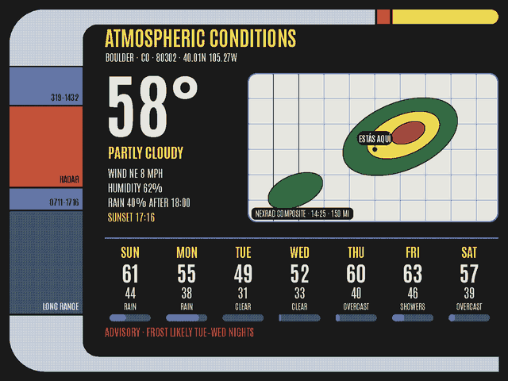

# Ventanal

A seasonal window onto public-domain museum art, an LCARS-inspired weather
console, and a licence-gated ham solar screen on an **Inkplate 13SPECTRA**.
A small host such as a Raspberry Pi renders the six-colour images; the board
downloads them, displays the selected screen, and sleeps. Cached screens work
without Wi-Fi. Ventanal 1.0.0 is free software under GPL-3.0-or-later.





These previews come from the deterministic test goldens, rather than live owner
data. The weather example is Boulder, CO 80302 (40.01 N, 105.27 W); solar uses a
public test location and the “CALL SIGN” placeholder. Colours simulate the panel.

## Requirements and architecture

- Inkplate 13SPECTRA: 1600 × 1200 six-colour panel, ESP32-S3, 32 MB flash,
  OPI PSRAM, Wi-Fi, and a suitable battery/USB supply. Full refresh takes about
  19 seconds; there is no partial refresh or charging-state sensor.
- Linux host with Python **3.13+**, systemd, network access to the data sources,
  and enough storage for museum images, frames and the local FCC index.
  The deployment installer targets Debian-family systems.
- Build computer with Arduino CLI, Soldered's ESP32 core and Inkplate library,
  USB serial support, and Python with esptool/pyserial.

The host fetches art/weather/solar data, quantises images against a calibrated
palette and publishes VNF frames plus a manifest. The board verifies downloads,
keeps an atomic flash cache, overlays battery/time, refreshes only when needed,
and enters deep sleep. systemd runs the web service and scheduled render/FCC jobs.

## Setup

### Host

On the Linux host, clone this repository and install:

```sh
sudo ./server/deploy/install.sh
```

The installer creates a `ventanal` service account, a durable package and venv
under `/opt/ventanal`, state under `/var/lib/ventanal` and `/var/cache/ventanal`,
and systemd services/timers. It copies
[ventanal.example.toml](server/ventanal.example.toml) to
`/etc/ventanal/ventanal.toml` only if that file does not exist. Edit that private
file for your installation; never commit it. For manual configuration, copy the
example there before starting the services.

The example sections are:

| Section | Purpose |
| --- | --- |
| `location` | US ZIP or latitude/longitude and place name; IANA timezone |
| `display` | Imperial/metric units and 12/24-hour clock |
| `schedule` | Local quiet hours, weather interval and daily art slots |
| `art` | Museums, repeat window, screen-fit/monotone filters, ignored identities |
| `art.seasons` | Date ranges and search terms; repeated table entries |
| `art.credentials.paris` | Optional Paris Musées token; keep private |
| `weather` | Radar source/radius, marker caption and optional NWS contact |
| `panel` | Six measured RGB colours, updated through Calibration |
| `server` | HTTP/HTTPS listeners, output and cache directories |
| `ham` | Optional US amateur call sign for local FCC verification |

Battery calibration adds optional `battery.full_mv`. Auth, transport identities
and Extras licences live separately in private state; they are not TOML settings.

Visit `http://192.168.0.10:8765` (substitute your host address). On first visit,
choose a password and confirm it. Explicitly skipping the password requires a
second confirmation and leaves the installation unprotected. Password setup
starts HTTPS; follow the Security pairing procedure below before using the board.
Use **Settings** to adjust location, schedules and sources; fields save directly.

### Firmware

Follow the [firmware guide](firmware/README.md) for toolchain installation and
hardware details. Copy `firmware/ventanal/config.example.h` to the git-ignored
`firmware/ventanal/config.h` and edit it privately:

- Set Wi-Fi SSID/password and the host URL (plain example
  `http://192.168.0.10:8765`; paired example `https://192.168.0.10:8766`).
- Set the POSIX timezone, wake interval, quiet start/end in minutes after midnight,
  and clock format to match the host. Host and board scheduling are configured
  separately.
- Choose landscape rotation `1` or `3` for the physical mounting orientation.
- For password-protected operation, copy the certificate and device key from
  **Settings → Security → Reveal board values**. Keep them private.

With the documented core/libraries installed, build and upload from the repo root:

```sh
FQBN='soldered-inkplate-boards:esp32:Inkplate13SPECTRA:FlashSize=32M,FlashMode=opi,PSRAM=opi,PartitionScheme=custom,DebugLevel=none'
arduino-cli compile --fqbn "$FQBN" --build-path firmware/build/release \
  --build-property upload.maximum_size=4194304 \
  --build-property recipe.hooks.objcopy.postobjcopy.3.pattern=/usr/bin/true \
  --build-property recipe.hooks.objcopy.postobjcopy.4.pattern=/usr/bin/true \
  firmware/ventanal
server/.venv/bin/python firmware/tools/upload.py firmware/build/release --port /dev/cu.YOUR_BOARD
```

Use Python with esptool installed (the [firmware guide](firmware/README.md)
shows how to prepare it). Substitute your serial port. The project uploader checks
our custom partitions and writes the app at `0x20000`; the stock Arduino uploader,
merged image and generated flash arguments use incompatible offsets. The helper
preserves the filesystem. Keep build output out of commits. On cold boot the
board connects, obtains the manifest, caches frames and displays its selection.

## Using Ventanal

- **Single WAKE press:** cycle cached art, weather, optional solar and enabled
  Extras screens. No Wi-Fi is needed.
- **Double WAKE press:** cycle the three cached spare artworks. Spares give you
  another painting immediately; the next online refresh reports skips/refills.
- **Long WAKE press:** refresh online and redraw the current screen. Exact
  classification timing and debounce rules are in the
  [firmware guide](firmware/README.md#wake-button-gestures).

Art changes on configured seasonal slots. Weather includes current conditions,
seven-day forecast, alerts and radar. Solar appears only after the local ham
licence check succeeds. Quiet hours suppress scheduled wakes; button actions
remain available. Low battery lengthens the wake interval, and critical voltage
shows a charge warning and leaves only button wake enabled. The readout records
the last draw, not every network check.

The web pages provide:

| Page | Controls and information |
| --- | --- |
| Status | Last check-in, estimated battery, firmware/server versions, next update, previews and recent activity |
| Art | Current/spare works, skipped works and ignored list; ignore/unignore individual source identities |
| Settings | Location, units, schedules, sources, seasonal terms, filtering and ham licence status; Security link |
| Calibration | Chart publication, original photo upload, measured palette preview/apply and restoration |
| Extras | Installed features, optional catalogue and offline licences; see [Extras](docs/extras.md) |

A skip records a preference event; it does **not** permanently ignore the work.
Use Art's ignored controls (or `art.ignored` identities such as `met:12345`) to
exclude a work from main art and spares. **Screen-fit only** admits suitable
landscape works; the monotone filter normally excludes monochrome works, and
**Include monotone** admits them. See [art sources and filters](docs/art-sources.md)
for the heuristic limits.

For battery calibration, fully charge the battery, let the board report its
voltage, then choose **Battery is full — set as 100%** on Status and confirm.
Reset there to restore the default curve. Percentage remains an estimate; the
board cannot detect charging or USB power.

For colour calibration, open Calibration and publish its chart. Refresh the
board, photograph the chart in indirect daylight without glare, and include
plain white paper. Prefer original camera RAW/DNG (enable Apple ProRAW or your
camera's RAW mode); original HEIC is also accepted, with lower accuracy than RAW.
Transfer the original file without messaging-app recompression, upload it, then
pick the outer chart corners **TL, TR, BR, BL**. Optionally drag a white-paper
reference rectangle. Preview the measured colours before applying them; the page
also offers restoration. This changes the host palette, not firmware settings.

Met, AIC and Cleveland are enabled by default. Rijksmuseum, NGA and SMK are
available too. **Wikimedia Commons is opt-in:** public-domain artwork metadata
is not a guarantee that every reproduction is free to reuse in every jurisdiction;
review the file's licence and the legal notice in Settings. Paris Musées needs a
free API token and remains pending live schema verification; keep it disabled
until verified. [Source documentation](docs/art-sources.md) includes token steps,
rights checks and provider terms.

## Security and pairing

With a password and security enabled, the browser/board use HTTPS, the board pins
the host certificate, manifests and board reports are authenticated, and signed
manifest hashes verify frame contents. There is no insecure TLS fallback.
On older password installations, explicitly choose **Settings → Security → Enable
security**; installing an update does not rotate an existing identity.

Compare the HTTPS certificate SHA-256 fingerprint with the Security page before
trusting it. Reveal the board values privately, copy the complete PEM and device
key into `config.h`, set the matching HTTPS host URL, then rebuild/upload.
Certificate regeneration requires updating the board certificate; **Re-pair board**
requires updating its key. After NVS loss, re-pair rather than resetting replay
protection. Never publish these values or private configuration files. See the
[transport details](firmware/README.md#password-protected-transport).

## Ham solar screen

The core solar screen is free for licensed US amateur operators. Enter your call
sign in Settings; status, expiry and ZIP are checked against a locally downloaded
FCC ULS index. **Your call sign is never sent anywhere.** NOAA/NASA data requests
are independent of your identity. Solar shows space-weather observations, alerts,
solar imagery and propagation estimates; estimates are not a communications
availability guarantee. See [solar documentation](docs/solar.md).

## Privacy

Your 5-digit ZIP is sent once (then cached locally) to `api.zippopotam.us`
(`zippopotam.us`) for geocoding unless latitude/longitude are set. A changed ZIP
or deleted cache needs a new lookup. The call sign is checked locally against the
FCC index and never transmitted. No third party receives the password, device
key, board telemetry or private settings except the request data listed below.
All Internet services necessarily see the server's public IP and User-Agent.

| Third-party hosts | What they receive |
| --- | --- |
| `api.zippopotam.us` | Five-digit ZIP for geocoding. |
| `api.open-meteo.com` | Latitude/longitude, timezone, units and requested forecast fields. |
| `api.weather.gov` | Latitude/longitude for alerts; optional configured NWS contact in User-Agent. |
| `mesonet.agron.iastate.edu`, `www2.census.gov` | Public radar image and map archive names; location cropping stays local. |
| `services.swpc.noaa.gov`, `sdo.gsfc.nasa.gov`, `data.fcc.gov` | Public solar-feed/image or complete FCC archive paths; no call sign or ZIP. |
| `collectionapi.metmuseum.org`, `api.artic.edu`, `www.artic.edu`, `openaccess-api.clevelandart.org`, `data.rijksmuseum.nl`, `raw.githubusercontent.com`, `api.nga.gov`, `api.smk.dk`, `commons.wikimedia.org` | Seasonal art search terms, object IDs, public dataset/image paths and sizes; no owner identity/location. |
| `apicollections.parismusees.paris.fr` (optional) | Art queries and the configured Paris Musées API token. |
| Museum-provided image/IIIF hosts and their redirects (including `images.metmuseum.org`, `openaccess-cdn.clevelandart.org`, `ids.si.edu`, `iiif.micr.io`, `iip.smk.dk`, `upload.wikimedia.org`, `www.parismuseescollections.paris.fr`) | Requested public artwork/image path and size. These hosts are supplied by the enabled museums' metadata and can change. |

Only enabled museum sources are queried. Your configured DNS resolver receives
hostname lookups. `pool.ntp.org` and `time.nist.gov` receive board time requests. Firmware sends
its authenticated telemetry and frame requests to your configured Ventanal host.
Extras may define additional network services; inspect their documentation before
enabling them. Installation tools contact their package and board repositories.

Museum image cache retention defaults to 2 GiB across the legacy root and plugin
image directories. Set `[art] image_cache_bytes` to a positive byte count to
change it. Least recently used images and corrupt unreferenced entries are
removed; current main/spare images stay pinned, even if they exceed the cap.

## Credits and licences

- Code: [GPL-3.0-or-later](LICENSE), Copyright (C) 2026 Stephen de la Vega.
  Contributions follow [CONTRIBUTING.md](CONTRIBUTING.md).
- Bundled fonts: [Antonio](server/src/ventanal/fonts/antonio/OFL.txt) and
  [Inter](server/src/ventanal/fonts/inter/OFL.txt), SIL Open Font License.
- Palette inspired by [ha-lcars “LCARS Modern”](https://github.com/th3jesta/ha-lcars).
  LCARS-inspired; not affiliated with or endorsed by CBS/Paramount.
- Data: [NOAA SWPC](https://www.swpc.noaa.gov/),
  [NWS](https://www.weather.gov/disclaimer),
  [Zippopotam](https://www.zippopotam.us/),
  [Open-Meteo](https://open-meteo.com/en/terms),
  [IEM NEXRAD](https://mesonet.agron.iastate.edu/docs/nexrad_composites/),
  [US Census](https://www.census.gov/about/policies/quality/guidelines.html),
  [NASA SDO](https://sdo.gsfc.nasa.gov/), and
  [FCC ULS](https://www.fcc.gov/wireless/data).
  Follow each provider's attribution, usage and availability terms; government
  feeds and third-party services carry no application availability guarantee.
- Museum images: Met, Art Institute of Chicago, Cleveland Museum of Art,
  Rijksmuseum, National Gallery of Art, SMK, Paris Musées and Wikimedia Commons.
  Images retain their own rights and attribution; the code licence does not
  relicense them. [Art source documentation](docs/art-sources.md) links terms
  and explains the public-domain/CC0 admission checks.

## Known limitations

The panel can stall during PON; bounded fast retry/recovery and the wake watchdog
limit a failed wake, but do not eliminate the hardware fault. The board toolchain
also emits a known LittleFS partition-subtype warning; use the documented custom
table/uploader. Paris Musées awaits live schema verification. Non-US ham licences
are not supported. Offline screens remain cached until a successful refresh;
there is no OTA firmware update. Battery life and palette accuracy depend on the
installation and calibration.

For future work see the [roadmap](docs/ROADMAP.md); for optional features see
[Extras](docs/extras.md).
