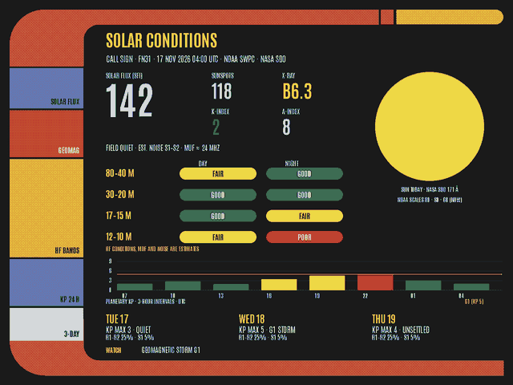

# Ventanal

A seasonal window onto public-domain museum art, an LCARS-inspired weather
console, and a licence-gated ham solar screen on an **Inkplate 13SPECTRA**.
A small host such as a Raspberry Pi renders the six-colour images; the board
downloads them, displays the selected screen, and sleeps. Cached screens work
without Wi-Fi. Ventanal 1.0.0 is free software under GPL-3.0-or-later.




These previews come from the deterministic test goldens. Weather uses St. Augustine,
Florida. Solar uses a public test location and the “CALL SIGN” placeholder.
Colours simulate the panel.

## Requirements and architecture

- Inkplate 13SPECTRA: 1600 × 1200 six-colour panel, ESP32-S3, 32 MB flash,
  OPI PSRAM, Wi-Fi, and a suitable battery/USB supply. Full refresh takes about
  19 seconds; there is no partial refresh or charging-state sensor.
- Linux host with Python **3.13+**, systemd, network access to the data sources,
  and enough storage for museum images, frames and the local FCC index.
  The deployment installer targets Debian-family systems.
- Build computer with CPython 3.13, a PlatformIO virtual environment, and USB
  serial support. The project installs its pinned ESP32 core and libraries.

The host fetches art/weather/solar data, quantises images against a calibrated
palette and publishes VNF frames plus a manifest. The board verifies downloads,
keeps an atomic flash cache, overlays battery/time, refreshes only when needed,
and enters deep sleep. systemd runs the web service and scheduled render/FCC jobs.

## Setup

### Host

On the Linux host, clone this repository and install:

```sh
sudo ./server/deploy/install.sh
```

The installer creates a `ventanal` service account, a durable package and venv
under `/opt/ventanal`, state under `/var/lib/ventanal` and `/var/cache/ventanal`,
and systemd services/timers. It copies
[ventanal.example.toml](server/ventanal.example.toml) to
`/etc/ventanal/ventanal.toml` only if that file does not exist. Edit that private
file for your installation; never commit it. For manual configuration, copy the
example there before starting the services.

The example sections are:

| Section | Purpose |
| --- | --- |
| `location` | US ZIP or latitude/longitude and place name; IANA timezone |
| `display` | Imperial/metric units and 12/24-hour clock |
| `schedule` | Local quiet hours, weather interval and daily art slots |
| `art` | Museums, repeat window, screen-fit/monotone filters, ignored identities |
| `art.seasons` | Date ranges and search terms; repeated table entries |
| `art.credentials.paris` | Optional Paris Musées token; keep private |
| `weather` | Radar source/radius, marker caption and optional NWS contact |
| `panel` | Six measured RGB colours, updated through Calibration |
| `server` | HTTP/HTTPS listeners, allowed hostnames, output and cache directories |
| `ham` | Optional US amateur call sign for local FCC verification |

Battery calibration adds optional `battery.full_mv`. Auth, transport identities
and Extras licences live separately in private state; they are not TOML settings.

Season ranges must cover the full year, including February 29. Before
upgrading an installation based on the old example, change winter's end date
from `02-28` to `02-29` if no other season covers that day. The installer
validates the live config before updating the installed package and
sets the configuration file's owner to the `ventanal` service account so the
web UI can replace it atomically. Use a regular file at the configured path.
The installer and writes from Settings and Calibration reject symlinked
configuration files. If the file cannot be parsed, the service
loads the newest usable settings backup from `/etc/ventanal/backups` and shows
it on Status. A Settings or Calibration save preserves the broken file as a
timestamped `unparseable-*.toml` copy in the backup directory before replacing it.

Open the host's HTTP address on port 8765. On first visit, enter the one-time
setup token printed by the installer and choose a password of at least 10
characters. Run this command on the host to issue a new token, including when
you want to set a password after choosing to run without one:

```sh
sudo -u ventanal /opt/ventanal/venv/bin/ventanal setup-token
```

Keep the token private. Both the password and the token travel over HTTP during
initial setup, so complete that step over a trusted connection. To run without
a password, enter the token and confirm the network-access warning.
For password setup, the token is consumed after the password and confirmation
pass validation. If enabling HTTPS fails after the token is consumed, issue a
new token with the command above.
Follow the Security pairing procedure below before using the board.
Use **Settings** to adjust location, schedules and sources; fields save directly.

### Firmware

Follow the [firmware guide](firmware/README.md) for toolchain installation and
hardware details. Copy `firmware/ventanal/config.example.h` to the git-ignored
`firmware/ventanal/config.h` and edit it privately:

- Set Wi-Fi SSID/password and the host URL (plain example
  `http://192.168.0.10:8765`; paired example `https://192.168.0.10:8766`).
- Set the POSIX timezone, wake interval, quiet start/end in minutes after midnight,
  and clock format to match the host. Host and board scheduling are configured
  separately.
- Choose landscape rotation `1` or `3` for the physical mounting orientation.
- For password-protected operation, copy the certificate and device key from
  **Settings → Security → Reveal board values**. Keep them private.

Install the [owner release public key](docs/updates.md#owner-signing-key) and
select your private header in `firmware/ventanal/platformio.local.ini` as
described in the firmware guide. With the PlatformIO venv installed, build
and upload from the repository root:

```sh
export UV_CONSTRAINT="$PWD/tools/release/platformio-constraints.txt"
firmware/.venv/bin/pio run -d firmware/ventanal -e normal && \
  firmware/.venv/bin/python firmware/tools/upload.py firmware/ventanal/.pio/build/normal --port /dev/cu.YOUR_BOARD
```

Substitute your serial port. The upload helper validates the OTA partition
layout and preserves NVS and the filesystem. On cold boot the board connects,
obtains the manifest, caches frames and displays its selection.

See [wireless firmware updates](docs/updates.md) for the wired OTA migration,
update approval, rollback and release signing.

Secure Boot and flash encryption are never enabled; see [security hardening](docs/security-hardening.md) for why and for the disabled scaffolding.

## Standalone mode

The Waveshare LCD can run without a Ventanal host. The board fetches its own
data and renders a daily artwork with two spare works, local weather, and an
optional solar conditions screen for licensed US amateur radio operators.

1. On the board, open **Settings → Setup Wi-Fi**. An unprovisioned board opens
   Wi-Fi setup on startup.
2. On your phone, join the board's hotspot using the details or QR code on the
   LCD, then open the setup page at the address shown on the board.
3. Choose your Wi-Fi network, enter its password and your US ZIP code, and
   select units and a 12- or 24-hour clock. Enter your call sign to enable
   solar. Leave the optional host address empty for standalone mode, or select
   **Leave the host and run on its own** when switching from a paired host.
   Tap **Save and connect**.

- The free Open-Meteo API is for non-commercial use. Its weather data requires
  attribution. US alerts come from the National Weather Service API at
  `api.weather.gov`, which requires a User-Agent. [Open-Meteo terms](https://open-meteo.com/en/terms)
  · [NWS API documentation](https://www.weather.gov/documentation/services-web-api)
- Solar conditions and imagery come from public NOAA Space Weather Prediction
  Center and NASA Solar Dynamics Observatory feeds. [NOAA SWPC](https://www.swpc.noaa.gov/)
  · [NASA SDO](https://sdo.gsfc.nasa.gov/)
- Art comes from the Cleveland Museum of Art and The Met's open-access
  collections (CC0). The Art Institute of Chicago is skipped for now because
  its IIIF images use progressive JPEG, which the board cannot decode.
  [Cleveland Open Access](https://www.clevelandart.org/open-access)
  · [The Met Open Access](https://www.metmuseum.org/hubs/open-access)

The FCC License View API has been retired. The board trusts the call sign you
enter and shows it as **unverified**. The geocoder receives your ZIP code, and
the weather APIs receive the resulting coordinates. Your call sign stays on
the board. The board sends no personal data or telemetry to the project.

The board checks GitHub for firmware updates at most once a week during a
normal refresh. A compatible signed release changes the **Firmware updates**
button in Settings to **Update _version_ available**. Open it and choose
**Install** to approve the update on the board. You can also select **Check for
updates** on that page. See the [LCD firmware guide](firmware/lcd43b/README.md#standalone-mode).

## Using Ventanal

- **Single WAKE press:** cycle cached art, weather, optional solar and enabled
  Extras screens. No Wi-Fi is needed.
- **Double WAKE press:** cycle the three cached spare artworks. Spares give you
  another painting immediately; the next online refresh reports skips/refills.
- **Long WAKE press:** refresh online and redraw the current screen. Exact
  classification timing and debounce rules are in the
  [firmware guide](firmware/README.md#wake-button-gestures).

On the LCD, tap right/left to rotate art → weather → published solar (or back).
Double tap swaps the art through cached spares and back to the main painting,
then opens Art. Skips survive reboots and report on the next online refresh.
Art off hides artwork and makes double tap a no-op. Hold for 1.5 seconds to refresh.

In host mode, art changes on configured seasonal slots. Weather includes current
conditions, seven-day forecast, alerts and radar. The host publishes solar after
its local ham licence check succeeds. Quiet hours suppress scheduled wakes; button actions
remain available. Low battery lengthens the wake interval, and critical voltage
shows a charge warning and leaves only button wake enabled. The readout records
the last draw, not every network check.

The web pages provide:

| Page | Controls and information |
| --- | --- |
| Status | Last check-in, estimated battery, firmware/server versions, next update, previews and recent activity |
| Art | Current/spare works, skipped works and ignored list; ignore/unignore individual source identities |
| Settings | Location, units, schedules, sources, seasonal terms, filtering and ham licence status; Security link |
| Calibration | Chart publication, original photo upload, measured palette preview/apply and restoration |
| Extras | Installed features, optional catalogue and offline licences; see [Extras](docs/extras.md) |

A skip records a preference event; it does **not** permanently ignore the work.
Use Art's ignored controls (or `art.ignored` identities such as `met:12345`) to
exclude a work from main art and spares. **Screen-fit only** admits suitable
landscape works; the monotone filter normally excludes monochrome works, and
**Include monotone** admits them. See [art sources and filters](docs/art-sources.md)
for the heuristic limits.

For battery calibration, fully charge the battery, let the board report its
voltage, then choose **Battery is full — set as 100%** on Status and confirm.
Reset there to restore the default curve. Percentage remains an estimate; the
board cannot detect charging or USB power.

For colour calibration, open Calibration and publish its chart. Photo upload
requires JavaScript. Refresh the board, photograph the chart in indirect
daylight without glare, and include plain white paper.
Prefer original camera RAW/DNG (enable Apple ProRAW or your
camera's RAW mode); original HEIC is also accepted, with lower accuracy than RAW.
Transfer the original file without messaging-app recompression, upload it, then
pick the outer chart corners **TL, TR, BR, BL**. Optionally drag a white-paper
reference rectangle. Preview the measured colours before applying them; the page
also offers restoration. This changes the host palette, not firmware settings.
Each palette write saves the previous TOML to a private timestamped backup.

Met, AIC and Cleveland are enabled by default. Rijksmuseum, NGA and SMK are
available too. **Wikimedia Commons is opt-in:** public-domain artwork metadata
is not a guarantee that every reproduction is free to reuse in every jurisdiction;
review the file's licence and the legal notice in Settings. Paris Musées needs a
free API token and remains pending live schema verification; keep it disabled
until verified. [Source documentation](docs/art-sources.md) includes token steps,
rights checks and provider terms.

## Security and pairing

The server accepts requests addressed to IP literals, `localhost`, its machine
hostname, that hostname with `.local` appended, and the DNS names stored in its
active certificate. To use a fully qualified domain name (FQDN) in open mode,
add it to `server.allowed_hosts` in the TOML file and restart the service.
Use the same setting for any additional DNS names, without schemes or ports.

With a password and security enabled, the browser/board use HTTPS, the board pins
the host certificate, manifests and board reports are authenticated, and signed
manifest hashes verify frame contents. There is no insecure TLS fallback.
On older password installations, explicitly choose **Settings → Security → Enable
security** to create an identity. Existing certificates stay in use across upgrades
until you explicitly regenerate them. New certificates are self-signed TLS server
certificates for the Ventanal host. Verify the SHA-256 fingerprint over a trusted
channel before accepting the certificate for this site in your browser. Keep it
out of your system's CA trust store.

For an initial pairing, use **Settings → Security → Reveal board values**, then
configure and flash the board as described under Firmware above.

For a Waveshare LCD, enable `devices.lcd43b` on the server. In **Settings →
Security → LCD pairing**, enter a unique pairing ID for the board and select
**Pair LCD**. Copy its certificate and values into your private LCD build
configuration and flash the board. Use **Reveal LCD values** to retrieve an
existing pairing. Use **Re-pair LCD (new device key)** after erasing the board's
NVS or to rotate its key. Each pairing has its own replay counter, including
when multiple LCDs use the same published feed. LCD check-ins are stored
separately from the e-paper status and battery calibration.

Coordinate regeneration with the board flash. The current pin stops working
for new TLS connections as soon as the server starts presenting the new certificate.

1. Save the current public PEM from **Settings → Security → Reveal board
   values** for the rollback test. Then confirm and select **Regenerate certificate**.
   On a systemd installation you can also rotate from the host as follows.

   ```sh
   sudo systemctl stop ventanal-serve.service
   sudo -u ventanal /opt/ventanal/venv/bin/ventanal regenerate-certificate --confirm
   sudo systemctl start ventanal-serve.service
   ```

2. Open **Settings → Security → Reveal board values** and copy the complete
   new PEM into `VENTANAL_HOST_CERT_PEM` in your private build configuration. Set
   `VENTANAL_HOST_URL` to an HTTPS URL whose hostname or IP is in the certificate.
   For a flash where rollback must work without another upload, put both complete
   PEM blocks, separated by a newline, in the same C++ raw string. This lets
   the board connect when the server presents either certificate. Remove the
   previous PEM in a later wired settings update after verifying the new certificate.
   Regeneration preserves the device key and replay counter. For a fresh
   pairing, NVS loss, or device-key rotation, confirm **Re-pair board (new
   device key)** for e-paper or **Re-pair LCD (new device key)** for the LCD
   and copy the new `VENTANAL_DEVICE_KEY` as well.
3. Rebuild and upload with the firmware instructions above. For a board that
   already has provisioned settings, use a new force-provision revision to
   apply the updated PEM and key. Verify a successful board check-in and
   frame refresh over HTTPS. Keep the pairing values private.
   See the [transport details](firmware/README.md#password-protected-transport).

If the board rejects the new certificate and still trusts the previous PEM,
confirm **Restore previous certificate** on the Security page. The server
presents the previous certificate on new connections immediately and preserves
the current device key and replay counter. The restore uses up the saved
certificate. Each regeneration saves the certificate and private key it replaces.
On a systemd installation, use the same stop/start sequence above with
`restore-certificate --confirm` in place of `regenerate-certificate --confirm`.
Both certificate commands refuse to run against a cache directory used by a
running Ventanal server. While a rollback certificate is saved, regeneration
requires **Discard the saved rollback certificate** in Settings → Security or
`--discard-previous` (alias `--force`) on the CLI. This replaces the saved
rollback identity with the certificate that is currently active.

On a system installation, run cache-writing CLI commands as
`sudo -u ventanal /opt/ventanal/venv/bin/ventanal …`. They require the effective
user to own the configured cache directory.

The installer gives the `ventanal` account write access to
`/etc/ventanal/ventanal.toml` and its containing directory so the service can
replace the file atomically. A compromised service can rewrite its own
configuration and create files in that directory.

## Ham solar screen

The core solar screen is free for licensed US amateur operators. Enter your call
sign in Settings; status, expiry and ZIP are checked against a locally downloaded
FCC ULS index. **Your call sign is never sent anywhere.** NOAA/NASA data requests
are independent of your identity. Solar shows space-weather observations, alerts,
solar imagery and propagation estimates; estimates are not a communications
availability guarantee. See [solar documentation](docs/solar.md).

## Privacy

Your 5-digit ZIP is sent once (then cached locally) to `api.zippopotam.us`
(`zippopotam.us`) for geocoding unless latitude/longitude are set. A changed ZIP
or deleted cache needs a new lookup. The call sign is checked locally against the
FCC index and never transmitted. No third party receives the password, device
key, board telemetry or private settings except the request data listed below.
All Internet services necessarily see the server's public IP and User-Agent,
`Ventanal/1.0.0 (+https://github.com/sdelavega/ventanal)`. NWS requests append
` <contact>` when an NWS contact is configured.

| Third-party hosts | What they receive |
| --- | --- |
| `api.zippopotam.us` | Five-digit ZIP for geocoding. |
| `api.open-meteo.com` | Latitude/longitude, timezone, units and requested forecast fields. |
| `api.weather.gov` | Latitude/longitude for alerts; optional configured NWS contact in User-Agent. |
| `mesonet.agron.iastate.edu`, `www2.census.gov` | Public radar image and map archive names; location cropping stays local. |
| `services.swpc.noaa.gov`, `sdo.gsfc.nasa.gov`, `data.fcc.gov` | Public solar-feed/image or complete FCC archive paths; no call sign or ZIP. |
| `collectionapi.metmuseum.org`, `api.artic.edu`, `www.artic.edu`, `openaccess-api.clevelandart.org`, `data.rijksmuseum.nl`, `raw.githubusercontent.com`, `api.nga.gov`, `api.smk.dk`, `commons.wikimedia.org` | Seasonal art search terms, object IDs, public dataset/image paths and sizes; no owner identity/location. |
| `apicollections.parismusees.paris.fr` (optional) | Art queries and the configured Paris Musées API token. |
| Museum-provided image/IIIF hosts and their redirects (including `images.metmuseum.org`, `openaccess-cdn.clevelandart.org`, `ids.si.edu`, `iiif.micr.io`, `iip.smk.dk`, `upload.wikimedia.org`, `www.parismuseescollections.paris.fr`) | Requested public artwork/image path and size. These hosts are supplied by the enabled museums' metadata and can change. |

Only enabled museum sources are queried. Your configured DNS resolver receives
hostname lookups. `pool.ntp.org` and `time.nist.gov` receive board time requests. Firmware sends
its authenticated telemetry and frame requests to your configured Ventanal host.
Extras may define additional network services; inspect their documentation before
enabling them. Installation tools contact their package and board repositories.

Museum image cache retention defaults to 2 GiB across the legacy root and plugin
image directories. Set `[art] image_cache_bytes` to a positive byte count to
change it. Least recently used images and corrupt unreferenced entries are
removed; current main/spare images stay pinned, even if they exceed the cap.

## Credits and licences

- Code: [GPL-3.0-or-later](LICENSE), Copyright (C) 2026 Stephen de la Vega.
  Contributions follow [CONTRIBUTING.md](CONTRIBUTING.md).
- Bundled fonts: [Antonio](server/src/ventanal/fonts/antonio/OFL.txt) and
  [Inter](server/src/ventanal/fonts/inter/OFL.txt), SIL Open Font License.
- Palette inspired by [ha-lcars “LCARS Modern”](https://github.com/th3jesta/ha-lcars).
  LCARS-inspired; not affiliated with or endorsed by CBS/Paramount.
- Data: [NOAA SWPC](https://www.swpc.noaa.gov/),
  [NWS](https://www.weather.gov/disclaimer),
  [Zippopotam](https://www.zippopotam.us/),
  [Open-Meteo](https://open-meteo.com/en/terms),
  [IEM NEXRAD](https://mesonet.agron.iastate.edu/docs/nexrad_composites/),
  [US Census](https://www.census.gov/about/policies/quality/guidelines.html),
  [NASA SDO](https://sdo.gsfc.nasa.gov/), and
  [FCC ULS](https://www.fcc.gov/wireless/data).
  Follow each provider's attribution, usage and availability terms; government
  feeds and third-party services carry no application availability guarantee.
- Museum images: Met, Art Institute of Chicago, Cleveland Museum of Art,
  Rijksmuseum, National Gallery of Art, SMK, Paris Musées and Wikimedia Commons.
  Images retain their own rights and attribution; the code licence does not
  relicense them. [Art source documentation](docs/art-sources.md) links terms
  and explains the public-domain/CC0 admission checks.

## Known limitations

The panel can stall during PON; bounded fast retry/recovery and the wake watchdog
limit a failed wake, but do not eliminate the hardware fault. The board toolchain
also emits a known LittleFS partition-subtype warning; use the documented custom
table/uploader. Paris Musées awaits live schema verification. Non-US ham licences
are not supported. Offline screens remain cached until a successful refresh.
Battery life and palette accuracy depend on the installation and calibration.

For future work see the [roadmap](docs/ROADMAP.md); for optional features see
[Extras](docs/extras.md).
